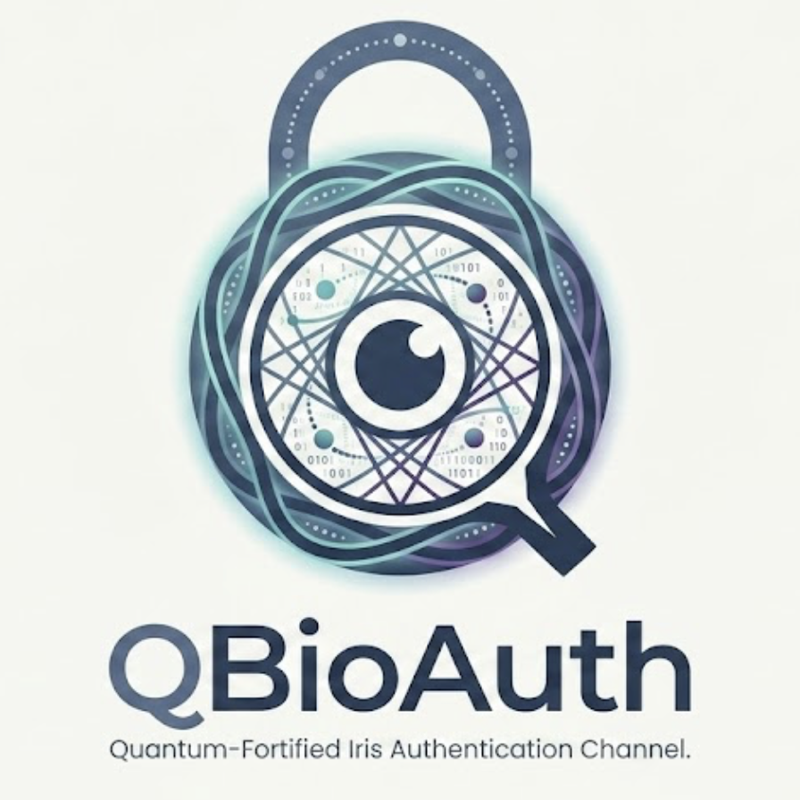
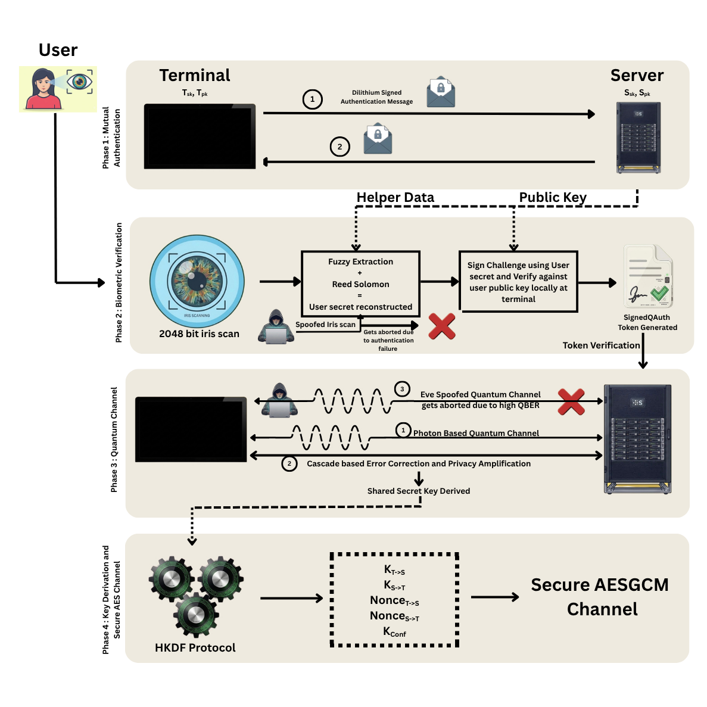
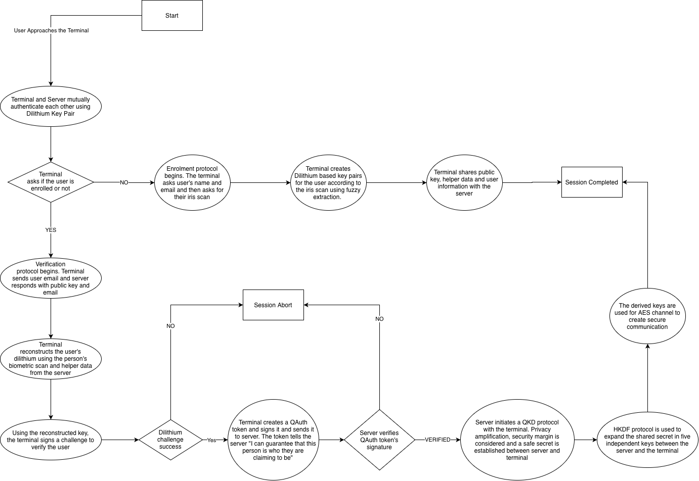
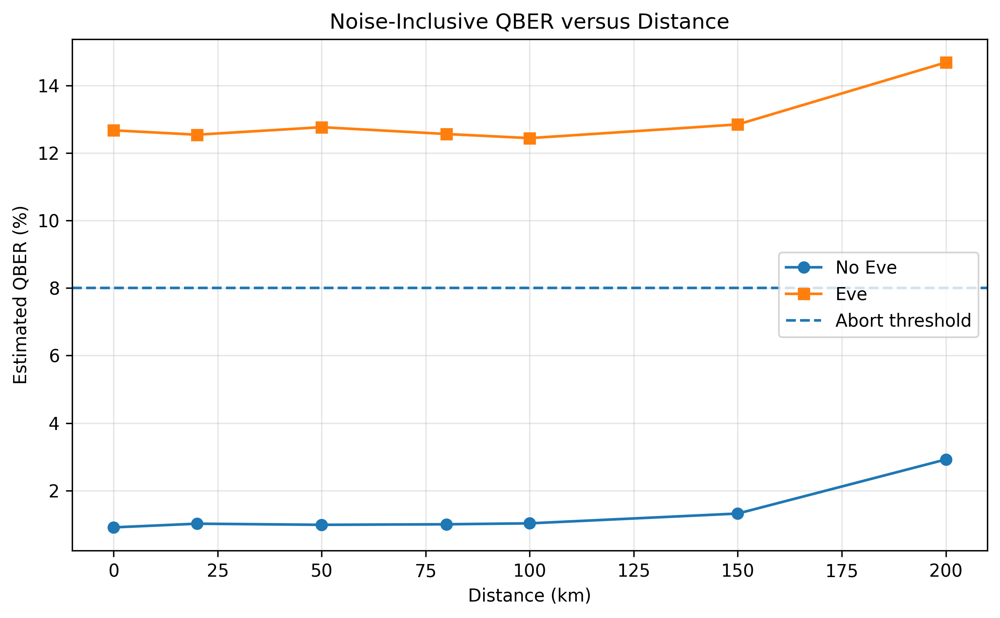
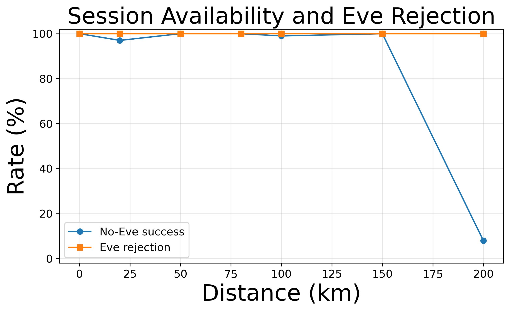
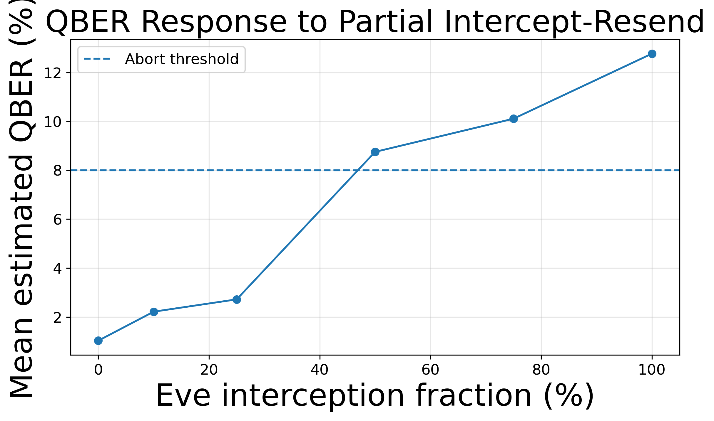
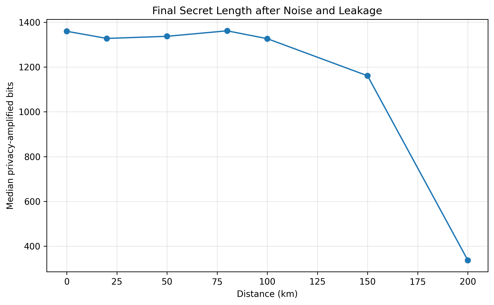

<p align='center'></p>

# QBioAuth

### Biometric + Post-Quantum + QKD + AES Mutual Authentication Protocol

---

## 📝 Brief Overview

QBioAuth is a four-layer mutual authentication protocol that fuses **iris biometrics**, **post-quantum signatures (ML-DSA-65 / Dilithium)**, **quantum key distribution (T12-inspired biased-basis BB84)**, and **AES-256-GCM** into a single, end-to-end pipeline built and validated as a real cryptographic system, not a toy simulation. A Terminal and a Server mutually authenticate using PQC signatures, a user enrolls or verifies using a fuzzy-extractor-protected iris code (the raw biometric never touches the server), and the two nodes then run a signed QKD exchange to derive a fresh shared secret every session, which is expanded via HKDF into a live AES-GCM secure channel. An intercepting adversary on the quantum channel is provably detectable. An intercept-resend attack drives the estimated QBER past the abort threshold and the session is rejected before any key material is ever derived.

The whole pipeline lives in a single Google Colab notebook, wrapped in a FastAPI server that streams every protocol step as a structured event over a WebSocket, and a React + TypeScript frontend renders the protocol **live**. A network diagram of Terminal/Server/User nodes animates the entire protocol in real time as the real cryptography executes, plus controls to trigger enrollment, authentication, a live intercept-resend attack demo, and encrypted messaging over the freshly-derived AES channel.

---

## 📸 Architecture & Protocol Flow

<p align='center'><br><em>Fig: The four protocol phases — Mutual Authentication, Biometric Verification, Quantum Channel, and Key Derivation into a secure AES-GCM channel</em></p><br><br>
<p align='center'><br><em>Fig: Full decision flow — enrollment vs. verification branching, QAuth token issuance, and abort paths</em></p><br><br>

---

## 📊 Validation Results — Noise-Inclusive Physical Simulation

The QKD layer was stress-tested with a full physical channel model (fibre attenuation, detector efficiency jitter, dark counts, intrinsic optical error) across a one-factor-at-a-time (OFAT) sweep of distance, eavesdropper interception fraction, and basis bias — **200 trials per configuration**. Full results live in [`OFAT_Outputs/`](./OFAT_Outputs).

<p align='center'></p>
<p align='center'></p>
<p align='center'></p>
<p align='center'></p>

**Key findings:**
- A full intercept-resend attack sits at a flat ~12–13% estimated QBER regardless of distance (0–200 km) always well clear of the 8% abort threshold, while natural channel noise alone stays under ~3% out to 150 km.
- Even a **partial** intercept-resend attack is caught: QBER crosses the abort threshold once Eve intercepts 50% of pulses. The threshold is tight enough to reject majority-interception attacks without false-aborting on real channel noise.
- Eve is rejected in essentially 100% of trials across every tested distance; genuine (no-Eve) sessions succeed near-100% of the time until channel noise itself starts approaching the threshold past ~150 km.
- Final privacy-amplified secret length degrades gracefully with distance as detected-pulse counts fall, dropping sharply only once fibre loss starts starving the pulse budget beyond 150 km.

See [`OFAT_Outputs/Graphs/`](./OFAT_Outputs/Graphs) for all 13 plots and [`OFAT_Outputs/final_experiment_configuration.json`](./OFAT_Outputs/final_experiment_configuration.json) for the exact sweep parameters.

---

## ✨ Features

**Protocol / Backend**
- PQC mutual authentication between Terminal and Server using ML-DSA-65 (Dilithium), including negative tests (tampered requests, replay attacks, stale messages)
- Fuzzy-commitment biometric enrollment — a 2048-bit iris code is never stored raw; only Reed–Solomon-protected helper data and a derived Dilithium keypair are kept server-side
- Fuzzy secret reconstruction tolerant of noisy (but genuine) iris scans, with negative tests against impostor iris samples
- T12-inspired 80:20 biased-basis QKD with signed basis reconciliation, full recursive-lookback Cascade error correction, and privacy amplification
- HKDF expansion of the shared QKD secret into five independent session keys (bidirectional AES keys, nonces, confirmation key)
- Live AES-256-GCM channel with a working message-replay and tampering test suite
- FastAPI + WebSocket layer that streams every internal step as a structured, typed protocol event — nothing about the real cryptography is faked; only the per-round Cascade breakdown is synthesized for animation pacing (the total is always the real total)
- A demo-only per-user raw iris registry lets the frontend trigger realistic noisy re-scans without needing a physical iris scanner — deliberately isolated from the real protocol's server-side storage guarantees

**Frontend**
- Live React Flow diagram of Terminal / Server / User nodes with animated edges that reflect real protocol phase transitions, in real time
- QBER and key-size metric cards, with a distinct alarm treatment (pulsing red edge, "🚨 ATTACK DETECTED" banner) when an intercept-resend attack is actually caught — separate from a generic natural-noise failure
- Full event log, and a replay system that re-drives a completed run's already-received events at adjustable speed, without touching the backend
- Runtime-configurable backend URL (no rebuild needed when the Colab tunnel URL rotates)
- User-held iris credentials — the one-time-issued iris code is surfaced in a dedicated callout with copy-to-clipboard, never silently retained beyond a local convenience cache
- Live encrypted chat over the AES-GCM channel with a per-message "show ciphertext" toggle (nonce / ciphertext / associated data, all real, all base64)
- A collapsible "Protocol configuration" panel that mirrors the notebook's tunable QKD parameters (basis bias, security margin, Cascade passes, detector event targets, distance, …), sourced live from the backend
- A prominent, real (not scripted) intercept-resend attack toggle for live demos

---

## 🏗️ System Architecture

```
[ Google Colab runtime ]
  - validated QBioAuth crypto pipeline (Python)
  - FastAPI app wrapping pipeline calls, emits protocol events
  - runs on localhost:8000 inside the Colab VM
       |
       | cloudflared quick tunnel (ephemeral HTTPS URL,
       | changes every time the Colab runtime restarts)
       v
[ Public HTTPS/WSS URL, e.g. https://random-words.trycloudflare.com ]
       ^
       | WebSocket + REST, CORS open (demo-only)
       |
[ React frontend — qbioauth-frontend/, deployed separately or run locally ]
  - connects to the tunnel URL, entered/stored at RUNTIME,
    not baked in at build time
```

---

## 🧬 Protocol Walkthrough

| Phase | What happens |
|---|---|
| **Phase 0 — Primitives** | ML-DSA-65 (Dilithium) wrapper, HKDF, AES-GCM wrapper, Qiskit-based simulator sanity checks, synthetic iris generator, protocol message envelope |
| **Phase 1 — Node Identities** | Terminal and Server declared as `IsolatedNode` objects, each with a hardware-backed-style Dilithium signing vault and a trusted-peer registry |
| **Phase 2 — Mutual Authentication** | Signed challenge/response protocol between Terminal and Server, hardened against tampered requests, replay attacks, and stale messages |
| **Phase 3A — Enrollment** | Iris code captured → fuzzy commitment created via Reed–Solomon → a Dilithium keypair is derived from the biometric and registered server-side (helper data + public key only) |
| **Phase 3B — Verification** | A fresh (possibly noisy) iris scan reconstructs the user's Dilithium key via fuzzy secret reconstruction; a local challenge is signed to prove possession, tested against exact, noisy-genuine, and impostor samples |
| **Phase 4 — QKD + AES** | Signed 80:20 biased-basis quantum transmission → basis reconciliation → QBER parameter estimation (abort on threshold breach) → recursive-lookback Cascade reconciliation → privacy amplification → HKDF → live AES-256-GCM channel |
| **End-to-End Pipeline** | Single executable cell chaining all four phases into one real authentication + secure messaging run |
| **Phase 5 — GUI / API** | Configuration layer + the FastAPI/WebSocket bridge that the React frontend talks to |
| **Comparison Analysis** | The OFAT sensitivity study behind the [Validation Results](#-validation-results--noise-inclusive-physical-simulation) above |

---

## 📚 Tech Stack

<p align='center'>


</p>

| Layer | Technology |
|---|---|
| Post-quantum signatures | ML-DSA-65 (Dilithium) via `pqcrypto` |
| Quantum channel simulation | Qiskit + Qiskit Aer |
| Biometric protection | Fuzzy commitment + Reed–Solomon (`reedsolo`) |
| Symmetric channel | AES-256-GCM (`cryptography`) |
| Key derivation | HKDF-SHA-256 |
| Notebook GUI | Gradio |
| Live protocol API | FastAPI + WebSocket, tunneled via `cloudflared` |
| Frontend | React 18 + TypeScript + Vite |
| Frontend state | Zustand |
| Live protocol diagram | React Flow (`@xyflow/react`) |
| Styling | Tailwind CSS |
| Sensitivity analysis | NumPy, pandas, Matplotlib |

---

## 🗂️ Project Structure

```
QBioAuth/
├── Q_Bio_Auth.ipynb              # The entire protocol: primitives → auth → biometrics → QKD → AES → API → sensitivity study
├── Docs/
│   ├── QBioAuth_System_Arch.png  # Illustrated 4-phase protocol diagram
│   └── System_Architecture.png   # Full decision-flow chart
├── OFAT_Outputs/
│   ├── Graphs/                   # 13 sensitivity-study plots
│   ├── qbioauth_final_raw_trials.csv
│   ├── qbioauth_final_comparison.xlsx
│   └── final_experiment_configuration.json
│
└── qbioauth-frontend/             # React + TypeScript live protocol visualizer
    ├── src/
    │   ├── types/protocol.ts      # Full discriminated-union event/command types
    │   ├── lib/
    │   │   ├── apiClient.ts       # REST calls (health, system-info, users, config, noise sim)
    │   │   ├── protocolSocket.ts  # Low-level WebSocket wrapper
    │   │   ├── edgeVisualState.ts # Phase-state → diagram edge styling
    │   │   └── irisCredentialStorage.ts
    │   ├── store/protocolStore.ts # Zustand store — single source of truth for the live run
    │   ├── hooks/
    │   │   ├── useProtocolSession.ts
    │   │   └── useAnimatedNumber.ts
    │   ├── components/
    │   │   ├── diagram/           # ProtocolDiagram, TerminalNode, ServerNode, UserNode, ProtocolEdge
    │   │   ├── panels/            # MetricCards, EventLog, SystemInfoPanel, IrisCredentialModal
    │   │   ├── controls/          # ControlBar, MessageComposer, ReplayControls, QkdConfigPanel
    │   │   └── setup/             # BackendUrlSetup
    │   ├── App.tsx
    │   └── main.tsx
    ├── package.json
    ├── tailwind.config.ts
    └── vite.config.ts
```

---

## Getting Started

### 🔧 Prerequisites
- A Google account (to run the notebook on Colab)
- Node.js 18+ and npm (for the frontend)

### 🖥️ 1 — Run the protocol backend (Google Colab)

```bash
Open Q_Bio_Auth.ipynb in Google Colab
Runtime → Run till Cell Block 'Additional Requirement Phase 5 GUI'
```

Running the notebook end to end brings up the full crypto pipeline, starts the FastAPI app on `localhost:8000` inside the Colab VM, and opens a `cloudflared` quick tunnel that prints a public HTTPS/WSS URL. **This URL changes every time the Colab runtime restarts** — copy the freshly printed one each session.

### 🖥️ 2 — Run the frontend

```bash
git clone https://github.com/Vishesh-Goyal7/QBioAuth
cd QBioAuth/qbioauth-frontend
npm install
npm run dev
```

Open the printed local URL (default `http://localhost:5173`). On first load you'll be asked to paste the tunnel URL from step 1 — it's validated against `/health` and stored in your browser, with an easy way to change it later without rebuilding.

---

## 🔒 Design Notes

- **Raw biometric data never reaches the frontend or persists server-side.** No iris codes, private keys, or raw QKD secret bits appear in any API payload beyond the single, explicit, user-facing moment a newly enrolled user's own iris code is issued back to them.
- **Cascade reconciliation rounds shown in the live demo are presentation pacing**, not synthetic cryptography — the real pipeline only returns a final aggregate error count; the frontend's round-by-round animation always sums to that real total.
- **Enrolled users only persist for the life of the Colab runtime.** Restarting Colab wipes all enrolled demo users — this is expected for a live-demo tool, not a production identity store.
- Backend CORS is intentionally open (`allow_origins=["*"]`) for demo convenience and is a known, tracked simplification — not something to "fix" without also revisiting the whole runtime-URL model.

---

## 📃 License

MIT License © 2026 VisheshVerse

---

## 📝 Final Note

QBioAuth represents months of engineering across cryptography, quantum protocol simulation, biometric security, and full-stack development — from a Dilithium signing vault to a live-animated React protocol visualizer. If it helped you, inspired you, or made you think, we'd love to hear from you.

Feel free to ⭐ the repo or connect with us.

Stay curious.

---

## 🙋‍♂️ Author

**Vishesh Goyal**
[Mail](mailto:visheshvishu1@outlook.com) | [Portfolio](https://visheshverse.com) | [GitHub](https://github.com/Vishesh-Goyal7) | [LinkedIn](https://www.linkedin.com/in/vishesh-goyal-2k5)

---

<p align='center'>Developed and Maintained by <a href='https://visheshverse.com'>VisheshVerse</a></p>
